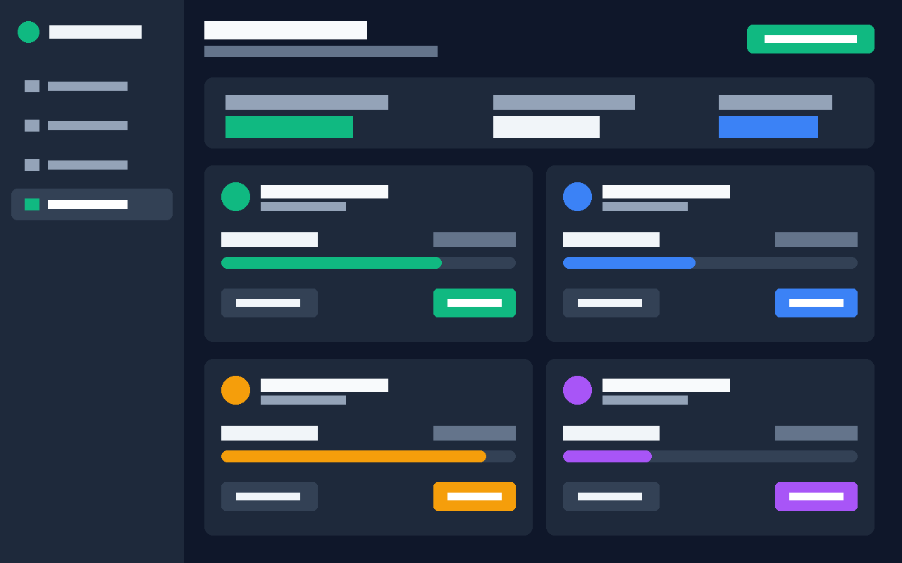

# 💰 Finance Tracker - Personal Money Management Web App

A modern, responsive, and intuitive Personal Finance & Money Tracker built with **React**, **TypeScript**, **Tailwind CSS**, and **Supabase**. It helps you track your daily income and expenses, monitor monthly budgets, set financial savings goals, and visualize spending trends with interactive charts.

---

## 📸 Screenshots

### 1. Dashboard & Spending Analytics


### 2. Budgets & Savings Goals Tracker


---

## ✨ Features

- **📊 Comprehensive Financial Dashboard:** Real-time summary of Total Balance, Monthly Income, Monthly Expenses, and Total Savings.
- **📈 Interactive Visualizations:** Income vs Expense bar charts and categorized spending donut charts.
- **💳 Transaction Management:** Categorized transactions (Food, Shopping, Housing, Entertainment, Salary, etc.) with real-time updates.
- **🎯 Savings Goals with Milestones:** Set financial targets, log contributions, and track progress visually.
- **🏷️ Budget Alerts & Tracking:** Keep track of spending limits per category to prevent overspending.
- **⚡ Modern Tech Stack:** Powered by Vite, React 18, TypeScript, Tailwind CSS, and Supabase backend.
- **📱 Fully Responsive:** Clean dark/modern aesthetic adapted for mobile, tablet, and desktop viewports.

---

## 🚀 Getting Started

### 1. Clone the repository
```bash
git clone https://github.com/<your-username>/personal-money-tracker.git
cd personal-money-tracker
```

### 2. Install dependencies
```bash
npm install
```

### 3. Setup Environment Variables
Create a `.env` file in the root directory:
```bash
cp .env.example .env
```
Add your Supabase project credentials:
```env
VITE_SUPABASE_URL=https://your-project.supabase.co
VITE_SUPABASE_ANON_KEY=your-anon-key
```

### 4. Run the development server
```bash
npm run dev
```

### 5. Build for Production (Netlify / Vercel)
```bash
npm run build
```
The output directory will be `dist/`, ready for direct deployment on Netlify or Vercel.

---

## 🛠️ Tech Stack

- **Frontend:** React 18, TypeScript, Vite
- **Styling:** Tailwind CSS, Lucide React Icons
- **Database / Backend:** Supabase (PostgreSQL)
- **Deployment:** Netlify / Vercel

---

## 📄 License
MIT License. Feel free to use and customize for your own personal finance needs!
